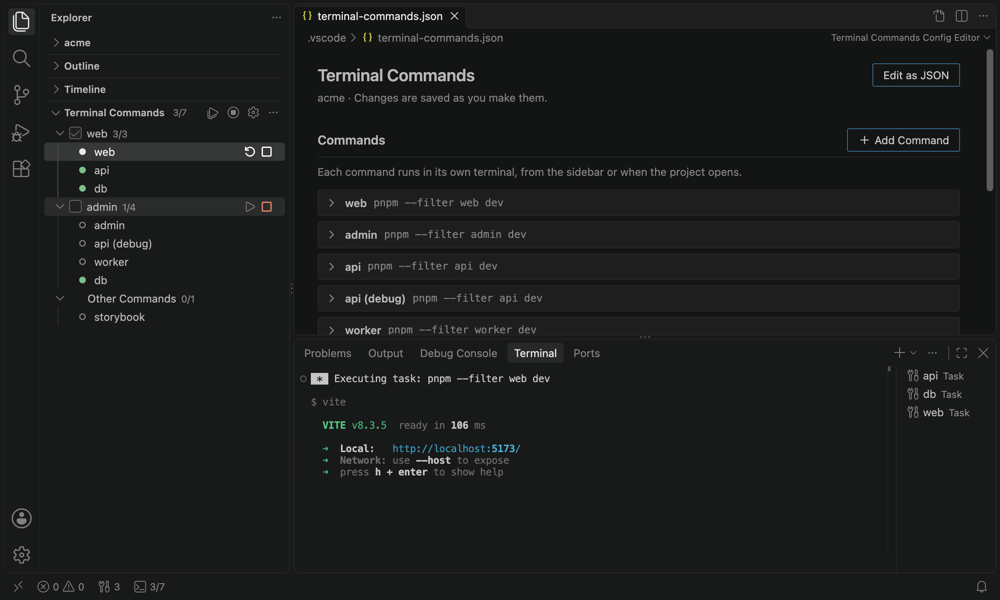

# Terminal Commands

Run your project's dev servers, workers and watchers from a list in the sidebar, each in its own terminal. The list lives in the repo, so everyone who opens the project gets the same commands, and the ones you always need can start by themselves when it opens.



- **One click** starts, stops or restarts a command. The view shows whether each one is running, stopped, or failed and with which exit code.
- **A terminal per command**, which keeps the output after the command exits.
- **Auto-start** the commands you always need when the project opens. You're asked first.
- **Groups** gather what one app needs, like its dev server, the API and the database, so they start together. Check a group, and it starts whenever you open the project.
- **A config editor** to add and change commands in a form. Or edit the JSON, with validation and completions.
- Works in **VS Code** and **Cursor**.

## Getting started

1. Install Terminal Commands from the [Visual Studio Marketplace](https://marketplace.visualstudio.com/items?itemName=peter-lewis.terminal-commands) for VS Code, or from [Open VSX](https://open-vsx.org/extension/peter-lewis/terminal-commands) for Cursor and other editors that use it. Or search for "Terminal Commands" in the editor's Extensions view.
2. Open your project, expand the **Terminal Commands** section at the bottom of the Explorer sidebar, and click **Create Config**. That creates `.vscode/terminal-commands.json`, filled in with the `package.json` scripts that start something long-running: `dev`, `start`, `serve` and `watch`, and variants like `dev:web`, and opens it in the config editor.
3. Add or change commands, and group them. Click a command in the sidebar to start it.

A config for a monorepo might look like this:

```jsonc
{
  "commands": [
    { "name": "web", "command": "pnpm --filter web dev" },
    { "name": "admin", "command": "pnpm --filter admin dev" },
    { "name": "api", "command": "pnpm --filter api dev", "autoStart": true },
    { "name": "worker", "command": "pnpm run dev", "cwd": "services/worker" },
    { "name": "storybook", "command": "pnpm run storybook", "env": { "PORT": 6006 } }
  ],
  "groups": [
    { "name": "web", "commands": ["web", "api"] },
    { "name": "admin", "commands": ["admin", "api", "worker"] }
  ]
}
```

Commit the file to share the commands with everyone who works on the project.

## The config file

`.vscode/terminal-commands.json` has a `commands` array, with an entry for each command, and optionally a `groups` array (see [Groups](#groups)). You can edit it in the [config editor](#the-config-editor), or as JSON with comments, which the editor validates and completes as you type.

| Field       | Required | Description                                                                                                          |
| ----------- | -------- | -------------------------------------------------------------------------------------------------------------------- |
| `command`   | yes      | The command line to run.                                                                                             |
| `name`      | no       | Label in the sidebar, and the name of the command's terminal and task. Must be unique. Defaults to the command line. |
| `cwd`       | no       | Working directory, relative to the workspace folder or absolute (`~` works). Defaults to the workspace folder.       |
| `env`       | no       | Environment variables to add, e.g. `{ "PORT": 3000 }`.                                                               |
| `autoStart` | no       | Start the command when the project opens. Defaults to `false`. See [Auto-start](#auto-start).                        |

Changes take effect when you save. An entry with a mistake is skipped, and the problem is listed at the top of the view; click it to open the config. In a multi-root workspace, each folder can have a config of its own, and the view groups the commands by folder.

## Groups

A group is a set of commands to start together, like everything one app needs while you work on it. Define each command once, under `commands`, and list it in as many groups as need it:

```jsonc
"groups": [
  { "name": "web", "commands": ["web", "api"] },
  { "name": "admin", "commands": ["admin", "api", "worker"] }
]
```

| Field      | Required | Description                                                      |
| ---------- | -------- | ---------------------------------------------------------------- |
| `name`     | yes      | Label in the sidebar. Must be unique among the groups.           |
| `commands` | yes      | Names of the commands in the group, in the order to list them.   |

If one app needs a command run differently, say the API with debug logging, add that as a command of its own, with its own name, and put it in that app's group:

```jsonc
{ "name": "api (debug)", "command": "pnpm --filter api dev", "env": { "DEBUG": "api:*" } }
```

The view lists the commands by group, and those in no group under **Other Commands**. A command in several groups is listed in each, but it's still one command, with one terminal.

- Hover over a group for **Start Group** and **Stop Group**.
- **Check a group** to start it now, and whenever you open the project. Check several to start them all. Which groups you check is your choice alone: it's remembered for the workspace on your machine, not written to the config, so everyone on a team can work on a different app.

## The config editor

**Open Config**, the gear in the view's title bar, opens the config in a form. So does **Edit Command**, at the command you picked. Changes are saved as you make them, and the rest of the file, comments included, stays the way you wrote it.

- Click a command or a group to edit it. Hover over one to move it up or down, or to delete it.
- **Add Command** and **Add Group** add new ones. A new command can go into groups straight away.
- **Edit as JSON**, or the button in the editor's title bar, switches to the JSON, and the same button in the JSON's title bar switches back. **Open Config (JSON)**, in the view's `...` menu, opens the JSON directly.

## Using the view

The **Terminal Commands** view is part of the Explorer sidebar. The first time you open a project that has commands, the view expands by itself. After that, it stays the way you leave it.

- **Click** a command to show its terminal, or to start it if it has none.
- Hover over a command for **Start**, **Stop** and **Restart**. Right-click it for **Show Terminal**, **Kill Terminal**, and **Edit Command**, which opens it in the config editor.
- Hover over a group for **Start Group** and **Stop Group**, and check it to start it whenever the project opens.
- The view's title bar has **Start All**, **Stop All** and **Open Config**, and shows how many commands are running, e.g. `3/5`.

The status bar shows the same count, plus the number of failed commands if there are any. Click it to open the view.

Every action is also in the Command Palette, under "Terminal Commands". To bind a key to one of your commands, pass its name as the argument:

```jsonc
// keybindings.json
[{ "key": "ctrl+alt+r", "command": "terminalCommands.restart", "args": "api" }]
```

That works for `terminalCommands.start`, `stop`, `restart`, `showTerminal`, `kill` and `edit`, and with a group's name for `terminalCommands.startGroup` and `stopGroup`. Without a name, they ask which one you mean.

## How commands run

Each command runs as a VS Code task, in a terminal of its own, through your default shell. On macOS, for example, that's `zsh -l -c "<command>"`. As a result:

- **The status is exact.** The view knows when the process starts and ends, and its exit code. Exit code 130 (Ctrl+C) counts as a normal stop, not a failure.
- **The output stays.** The terminal stays open after the command exits, so you can read why it crashed. Starting the command again reuses the terminal.
- **Stop sends Ctrl+C**, so dev servers can shut down cleanly. Press Stop again to send another. **Kill Terminal** ends the process outright and closes its terminal.
- **Reloading the window doesn't stop anything.** VS Code reconnects to the running commands after the reload, and the view picks them up again.
- **The shell isn't interactive.** Your `PATH` applies, but aliases and functions from `.zshrc` or `.bashrc` don't. Point `command` at scripts and programs instead.
- **The commands are tasks too.** They're listed under **Tasks: Run Task**, and `tasks.json` can refer to one by name, e.g. in `dependsOn`, as `{ "type": "terminalCommand", "name": "api" }`.

## Auto-start

Two things start when the project opens: the commands with `"autoStart": true`, for everyone who opens the project, and the [groups](#groups) you've checked, for you. A config in a repository can run anything on your machine, so:

- The extension only runs in [trusted workspaces](https://code.visualstudio.com/docs/editor/workspace-trust).
- The first time, it asks before auto-starting a workspace's `autoStart` commands, and lists them. It asks again whenever what would auto-start changes, like `direnv allow`: a command line, working directory or environment variable, or which commands auto-start. Renaming or reordering the other commands doesn't count.
- Checking a group counts as allowing its commands as they are. If they change, say after a `git pull`, it asks again before starting the group. Declining unchecks the group.
- **Terminal Commands: Reset Auto-Start Decisions** forgets your answers for the current workspace, and unchecks its groups.

Starting a command yourself never asks. Hover over a command to see what it runs.

Auto-start waits about 1.5 seconds after the window opens, so that after a reload it doesn't start a second copy of a command that's still running.

## Settings

| Setting                      | Default  | Description                                                                                                                                                                                                                   |
| ---------------------------- | -------- | ----------------------------------------------------------------------------------------------------------------------------------------------------------------------------------------------------------------------------- |
| `terminalCommands.autoStart` | `prompt` | `prompt` asks before auto-starting commands, and again when they change. `always` starts them without asking, and `never` doesn't start them. Can only be set in user settings, so a repository can't turn the prompt off. |

## Cursor and other editors

Terminal Commands is tested in VS Code on macOS and Linux, and in Cursor on macOS. It needs VS Code 1.93 or later, or an editor based on it. Windows should work too, but hasn't been tested yet.

Cursor titles terminal tabs with the running process (`node`, `zsh`) rather than the command's name. Use the sidebar to find a command's terminal.

## Troubleshooting

- **A command fails with exit code 127.** The shell couldn't find the program. Check that it's on your `PATH`, and keep in mind that aliases and shell functions aren't available.
- **A command doesn't stop.** Some programs ignore Ctrl+C, or take a while to handle it. Press Stop again, or use **Kill Terminal**.
- **Something else isn't right.** The **Terminal Commands** output channel (**View > Output**) logs what the extension does. For more detail, run **Developer: Set Log Level...**, choose Terminal Commands, then Debug. Please include the log when you [report a bug](https://github.com/peter-lewis/terminal-commands/issues).

## Contributing

Bug reports and pull requests are welcome. See [CONTRIBUTING.md](CONTRIBUTING.md) for how to build and test the extension.

## License

[MIT](LICENSE)
